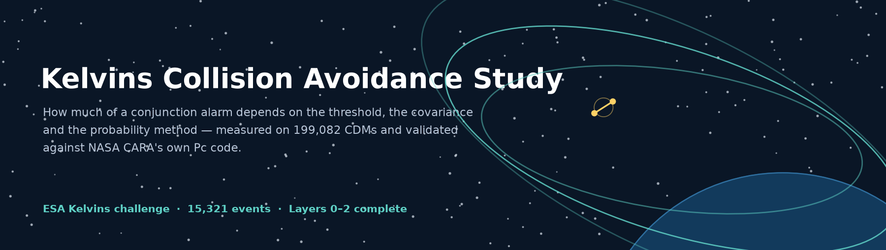
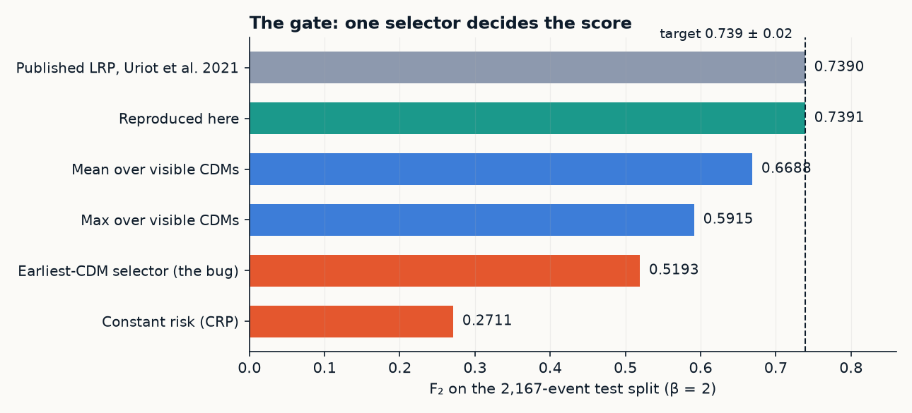
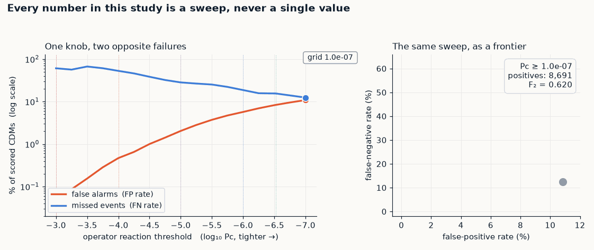
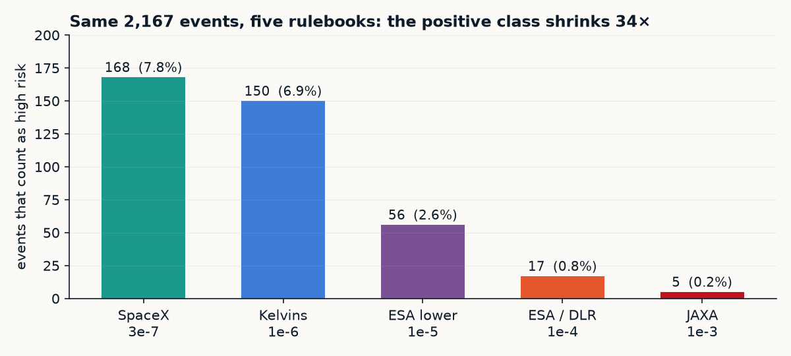
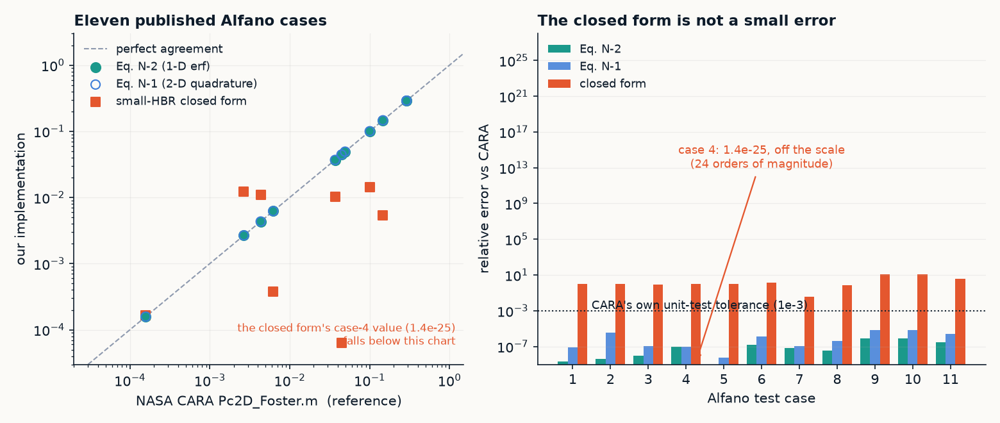
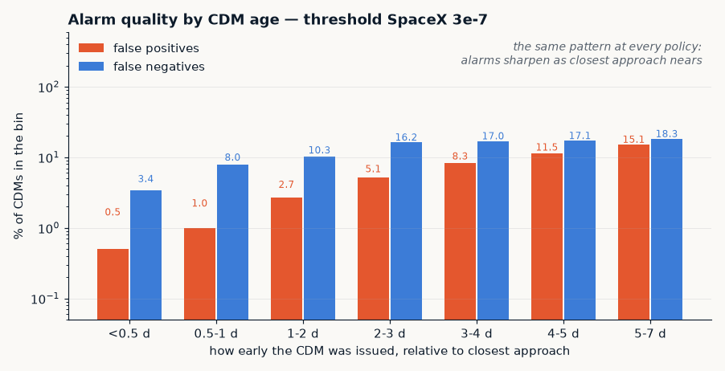
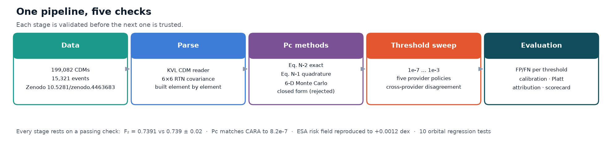

# Kelvins Collision Avoidance Study



This repository is a research notebook made public: a reproduction of the ESA
Kelvins *Spacecraft Collision Avoidance Challenge* baseline, with the orbital
mechanics, covariance handling and probability-of-collision maths rebuilt from
scratch underneath it, and an evaluation layer on top that asks a question the
competition never asked: how much of a "high risk" label is physics, and how
much is the operator's rulebook.

The short version of what came out of it: the published baseline reproduces to
four decimal places, one of the four common ways to compute collision
probability turns out to be wrong by orders of magnitude against NASA's own
reference code, and the alarms are least reliable when they arrive several days
before closest approach.

Layers 0 through 2 are finished. The forecasting model (layer 3), the live
replay (layer 4) and the report generator (layer 5) have not been started. The
[roadmap](notes/ROADMAP.md) is honest about which is which.

---

## The gate, first

Everything else in the repository is only worth reading if the baseline
reproduces. On the 2,167-event test split:

| Quantity | Published (Uriot et al., Table 3) | Reproduced here | Difference |
|---|---|---|---|
| **F₂** | **0.739** | **0.7391** | +0.0001 |
| MSE over high-risk events | 0.513 | 0.5129 | −0.0001 |
| Challenge loss `L = MSE_HR / F₂` | 0.694 | 0.6940 | 0.0000 |
| Constant-risk baseline (CRP) `L` | 2.5 | 2.5041 | +0.0041 |

Confusion matrix on those events: `TP = 115, FP = 63, FN = 35, TN = 1954`
(precision 0.646, recall 0.767). The full row is in
[`results/lrp_metrics.csv`](results/lrp_metrics.csv).



Getting there took one bug worth mentioning, because it is the kind of bug that
produces a perfectly reasonable-looking number. The "latest CDM before closest
approach" selector was sorting each event's CDMs by time-to-TCA and keeping the
last row, which quietly returns the *earliest* CDM instead of the newest one.
F₂ came out at 0.519. The fix is one word (`head` instead of `tail`), and the
gate is what caught it. Three more defects in the orbital layer, a wrong
perifocal x, swapped `atan2` arguments, and a misread implied exponent in a TLE
field, were caught by the regression tests in [`tests/`](tests/).

---

## Four findings

### "High risk" is a policy choice, and the choice moves the answer a lot

Operators disagree by three and a half orders of magnitude on where to draw the
line, from SpaceX's roughly 3 × 10⁻⁷ to JAXA's 10⁻³. On the same 2,167 events
that is 168 positives at one end and 5 at the other.



Across all 199,082 CDMs in the release, sliding the threshold from 10⁻³ down to
10⁻⁷ cuts the false-negative rate from 61% to 12% and pushes the false-positive
rate from 0.035% to 10.8%. A 300-fold swing in false alarms buys a five-fold
reduction in misses. Quoting "F₂ = 0.739" without naming the threshold is
quoting a number that has no fixed meaning.



### The small-HBR closed form should not be used, and CARA's own code shows why

NASA publishes its Pc toolkit and a set of Alfano test cases with
expected values. Running CARA's `Pc2D_Foster.m` under GNU Octave reproduces
those published values to 10⁻¹², so the reference is CARA itself. Against it,
the 1-D error-function form (Appendix N, Eq. N-2) agrees to 8.2 × 10⁻⁷. The
closed form used in a lot of operational software gives 1.4 × 10⁻²⁵ where CARA
says 4.9 × 10⁻², an error of twenty-four orders of magnitude, because the
collision disk still overlaps a long thin covariance ridge while its centre
sits ten sigma away.



### Early CDMs cry wolf

At SpaceX's threshold the false-positive rate rises
thirty-fold between a half-day and a week before closest approach (0.5% to
15.1%), while the false-negative rate moves much less.



### The predicted probabilities are not probabilities

LRP is over-confident everywhere: a calibration slope of 0.2 to 0.8 where 1.0 would be
honest. A constant predictor beats it on log loss at every threshold with
enough positives to measure. A two-parameter Platt map fitted on the training
split cuts log loss by 6.6× at the 3 × 10⁻⁷ threshold without changing the
ranking at all. The ordering is fine; the scale is not.

---

## How the pieces fit



Five stages, each with a check that has to pass before the next one is trusted.
The full walkthrough is in [`docs/overview.md`](docs/overview.md); the
end-to-end technical write-up is [`docs/technical-report.md`](docs/technical-report.md).

---

## Running it

Python 3.10 or newer, roughly 1 GB of RAM, and about 220 MB of free disk for the
dataset, which is not in this repository. It is a public Zenodo release.

```bash
python3 -m venv .venv && source .venv/bin/activate
pip install -r requirements.txt

# fetch the dataset from Zenodo (10.5281/zenodo.4463683) into ./data
python scripts/fetch_data.py

# the gate: reproduce the baseline
python scripts/reproduce_lrp.py

# regression tests for the orbital layer
python -m pytest tests/ -q
```

Expected output of the gate is `F2 = 0.7391` against a target of 0.739 ± 0.02.
If you have already unzipped the dataset somewhere, skip `fetch_data.py` and
point `KELVINS_DATA_ROOT` at the folder that contains `train_data.csv`.

The steps that need NASA's toolkit and GNU Octave are optional and are covered
in [`docs/reproduction.md`](docs/reproduction.md).

---

## What is where

```
.
├── src/                 the library: orbital mechanics, covariance, Pc, metrics
├── scripts/             one script per result table, plus the validation harness
├── tests/               regression tests for the orbital layer
├── results/             every CSV and plot the write-up quotes
├── notes/               working notes, one file per layer, plus the roadmap
├── docs/                the reading path: overview, report, reproduction, index
├── assets/              banner, diagrams and animations used in these docs
├── third_party/         NASA CARA toolkit, unmodified, with its NOSA terms
├── tools/make_figures.py  regenerates every image in assets/ from results/
├── requirements.txt
└── CITATION.cff
```

Start with [`docs/overview.md`](docs/overview.md) for the argument,
[`docs/results-index.md`](docs/results-index.md) to look up a specific number,
and [`docs/glossary.md`](docs/glossary.md) if a term is unfamiliar. If you want
to extend the work rather than read it, [`docs/handoff.md`](docs/handoff.md) is
the state-of-play document: what is done, what is open, and which traps have
already been stepped in.

---

## Status

| Layer | What it covers | State |
|---|---|---|
| 0: definitions | thresholds as a sweep, cross-provider disagreement | done |
| 1: Pc methods | Eq. N-1, Eq. N-2, Monte Carlo, HBR variants, CARA validation | done |
| 2: evaluation | FP/FN at 199k CDMs, calibration, attribution, interpretability | done |
| 3: forecaster | model that predicts final risk from CDMs visible ≥ 2 days out | not started |
| 4: live replay | SOCRATES ingest, rolling alert-quality report | not started |
| 5: reports | one command from data to a readable report | not started |

---

## Data, code and credits

The dataset is the ESA Kelvins release, CC-BY, DOI
[10.5281/zenodo.4463683](https://doi.org/10.5281/zenodo.4463683). It is not
committed here; `scripts/fetch_data.py` re-acquires it.

The NASA CARA toolkit in [`third_party/cara_analysis_tools`](third_party/cara_analysis_tools)
is copied unmodified from [nasa/CARA_Analysis_Tools](https://github.com/nasa/CARA_Analysis_Tools)
and carries its own NOSA terms (GSC-18593-1, GSC-18848-1, GSC-19027-1,
GSC-19374-1), which are reproduced alongside it. Nothing in this repository is
derived from CARA source code; it is used only as an external reference to check
numbers against. See [`docs/licensing.md`](docs/licensing.md) for the details.

If you use this work, [`CITATION.cff`](CITATION.cff) has the metadata GitHub
reads.

---

## A note on provenance

This repository is the author's research archive, reorganised for reading. The
files in `src/`, `scripts/`, `tests/`, `notes/` and `results/` are byte-for-byte
what came out of the working session; nothing was rewritten, retuned or
regenerated to look better. What changed is the layout (the project used to sit
in a subfolder called `kelvins_pc/`), a few file names that were working titles,
and the addition of this README, the `docs/` set, the figures in `assets/` and
the tool that draws them. [`docs/file-map.md`](docs/file-map.md) lists every
move and rename so the history can be followed.
